# SIP Retention Discovery Engine

[](https://www.python.org/downloads/)
[](https://fastapi.tiangolo.com)
[](LICENSE)
[]()

> A structured behavioral discovery engine and query system that surfaces why first-time mutual fund investors in India pause, reduce, or let lapse their Systematic Investment Plans (SIPs). Built for product and growth leaders to prioritize high-impact retention opportunities grounded in public investor discourse.

---

## Architecture Overview

```mermaid
flowchart TD
    subgraph DataCollection["1. Multi-Channel Snapshot Collection"]
        PS["Google Play Store"]
        AS["Apple App Store"]
        RD["Reddit (r/IndiaInvestments, r/mutualfunds)"]
        YT["YouTube SIP Video Comments"]
        FM["Value Research & TradingQnA Forums"]
        QR["Quora Q&A Discussions"]
        TW["Twitter / X Discourse"]
    end

    subgraph Preprocessing["2. Preprocessing & Filtering"]
        DEDUP["Deduplication\n(Exact MD5 + SimHash)"]
        SPAM["Spam & Bot\nHeuristics"]
        PII["PII Redaction\n(Regex Masking)"]
        REL["Relevance Classifier\n(Domain Heuristics + Groq)"]
        TAG["Groww & Competitor\nTagging"]
    end

    subgraph Extraction["3. Structured Signal Extraction"]
        GROQ["Groq LLM Engine\n(openai/gpt-oss-120b)"]
        SCHEMA["Pydantic Schema\nValidation & Auto-Repair"]
        SIGNALS["Behavioral Signals\n(Lifecycle, Barriers, Emotions, Outcomes)"]
    end

    subgraph Analysis["4. Opportunity Scoring & Clustering"]
        CODEBOOK["Codebook v1.0\n(6 Categories, 20 Sub-themes)"]
        SCORING["Composite Opportunity Scoring\n0.4*Freq + 0.4*Sev + 0.2*Breadth"]
        COMPARE["Continuer vs. Dropper\nStatistical Comparator"]
    end

    subgraph Delivery["5. Delivery & Query Interface"]
        API["FastAPI REST Backend\n(/metadata, /opportunities, /chat)"]
        GUARD["SEBI Compliance Guardrails\n(Dual-Layer Policy Interceptors)"]
        UI["Web Dashboard\n(Chat, Opportunity Explorer, Evidence Drill-Down)"]
    end

    DataCollection --> Preprocessing
    Preprocessing --> Extraction
    Extraction --> Analysis
    Analysis --> Delivery
```



---

## Corpus & Filtering Funnel

The empirical corpus represents **5,268 collected public items** filtered through a multi-stage anonymization pipeline:

```
  5,268  Raw Items Collected
 -1,086  Duplicate Items Removed (SimHash & Exact Hash)
   -781  Promotional Spam & Bot Messages Filtered
    (10  PII Records Redacted: Phone numbers, emails, folio IDs masked)
 -1,652  Irrelevant / Non-SIP Conversations Removed
     -7  Competitor-Only Messages Filtered
 ────────────────────────────────────────────────────────────
  1,742  Retained Analysis Corpus (1,523 Groww-Specific | 219 Platform-Agnostic)
```

---

## Key Features

1. **Persistent Data Scope Banner:** Always-visible context showing corpus counts, date observation window (Sept 2014 – Nov 2026), platform mix, and known corpus skews.
2. **Ranked Opportunity Explorer:** Prioritizes retention intervention themes using an empirical Composite Score ($0.4 \times \text{Frequency} + 0.4 \times \text{Severity} + 0.2 \times \text{Breadth}$).
3. **Traceable Evidence Drill-Down:** Direct modal inspection showing verbatim quotes with highlighted evidence spans, source attribution, lifecycle stage, and reported emotion.
4. **Natural Language Assistant:** Answers behavioral questions with auto-computed SQL breakdowns and verbatim citations (`[Record ID]`).
5. **SEBI Guardrails & Policy Enforcement:** 100% refusal compliance blocking investment advice, specific fund recommendations, competitor comparisons, and FOMO urgency framing.
6. **Full AI Evidence Log:** Complete audit trail tracking each pipeline stage from raw collection through gold standard validation.

---

## Directory Structure

```
SIP Discovery Engine/
├── config/                     # Pipeline configuration YAMLs
│   ├── codebook_v1.yaml        # Theme definitions (6 categories, 20 sub-themes)
│   ├── extraction.yaml         # Groq LLM model and prompt settings
│   ├── guardrails.yaml         # Prohibited keywords and evidence thresholds
│   ├── scoring.yaml            # Opportunity scoring weights and thresholds
│   └── sources.yaml            # Source collector configurations
├── data/                       # Local data directory
│   ├── sip_discovery.db        # SQLite database (raw, filtered, structured, opps, logs)
│   ├── gold_sample/            # 50 expert-labeled validation items
│   └── exports/                # Exported CSV, JSON, and schema manifests
├── docs/                       # Research and architecture documentation
│   ├── architecture.md         # System architecture specification
│   ├── implementation-plan.md  # Detailed phase-by-phase delivery plan
│   ├── research-findings-summary.md # 15-section empirical research findings report
│   └── ai-evidence-log/        # Validation report, failure cases, and provenance logs
├── scripts/                    # CLI execution runners
│   ├── run_all.py              # Single-command end-to-end pipeline runner
│   ├── run_collection.py       # One-time data collection runner
│   ├── run_preprocessing.py    # Preprocessing, filtering, and PII redaction
│   ├── run_extraction.py       # Groq LLM structured extraction runner
│   ├── run_analysis.py         # Opportunity scoring and clustering runner
│   ├── generate_findings.py    # Findings document population script
│   ├── validate_gold_sample.py # Gold standard agreement validation
│   ├── audit_guardrails.py     # 20-case guardrail compliance test
│   ├── check_performance.py    # Latency benchmark spot-check
│   └── export_dataset.py       # Dataset exporter (CSV/JSON/Parquet)
├── src/                        # Core application modules
│   ├── analysis/               # Theme clusterer, opportunity scorer, segment aggregator
│   ├── api/                    # FastAPI routes, middleware, and app entry point
│   ├── collectors/             # Multi-source data connectors
│   ├── db/                     # SQLite connection manager and migrations
│   ├── extraction/             # Groq LLM extractor, confidence scorer, validator
│   ├── models/                 # Pydantic data schemas
│   ├── preprocessing/          # Deduplication, PII redactor, spam and relevance filters
│   ├── query/                  # Query engine, intent classifier, vector search, synthesizer
│   ├── ui/                     # Web dashboard (HTML5, modern CSS, vanilla JS)
│   └── utils/                  # Config loader, logging, Groq client wrapper
└── tests/                      # Automated test suite (146 unit & integration tests)
```

---

## Getting Started

### 1. Prerequisites
- Python 3.11 or higher
- Git

### 2. Installation

Clone the repository and install dependencies:

```bash
git clone <repo-url>
cd "SIP Discovery Engine"

# Create and activate a virtual environment
python -m venv venv
# On Windows:
venv\Scripts\activate
# On Linux/macOS:
source venv/bin/activate

# Install project dependencies
pip install -e .
```

### 3. Environment Configuration

Copy the example environment file and configure your API keys:

```bash
cp .env.example .env
```

Edit `.env` to supply your Groq API key:

```ini
GROQ_API_KEY=gsk_your_groq_api_key_here
DATABASE_PATH=data/sip_discovery.db
```

---

## How to Run

### Option A: Run the End-to-End Pipeline (One Command)

Executes preprocessing, analysis, findings generation, gold benchmark validation, guardrail audit, and dataset export in a single run:

```bash
python scripts/run_all.py
```

*To include live LLM re-extraction over the whole corpus via Groq API:*
```bash
python scripts/run_all.py --with-extraction
```

### Option B: Launch the Web UI & API Server

Start the local FastAPI server:

```bash
python -m uvicorn src.api.app:app --host 127.0.0.1 --port 8000 --reload
```

Open your browser at:
- **Web Dashboard:** [http://localhost:8000/](http://localhost:8000/)
- **Interactive OpenAPI Docs:** [http://localhost:8000/docs](http://localhost:8000/docs)

### Option C: Run Individual Pipeline Stages

```bash
# 1. Run Preprocessing & Filtering
python scripts/run_preprocessing.py --no-llm

# 2. Run Theme Clustering & Opportunity Scoring
python scripts/run_analysis.py

# 3. Generate Research Findings Summary Document
python scripts/generate_findings.py

# 4. Benchmark Against Gold Standard Sample
python scripts/validate_gold_sample.py

# 5. Run Guardrail Refusal Audit
python scripts/audit_guardrails.py

# 6. Export Dataset to CSV/JSON
python scripts/export_dataset.py

# 7. Check Query Engine Latency
python scripts/check_performance.py
```

---

## Running the Automated Test Suite

Run the full pytest suite (146 tests across analysis, API, collectors, extraction, preprocessing, and query engine):

```bash
pytest tests/ -v
```

All 146 tests run locally in under 20 seconds.

---

## SEBI Guardrails & Compliance

The discovery engine enforces strict behavioral boundaries:
- **No Financial Advice:** Rejects queries like *"Which mutual fund should I buy?"* or *"Recommend top small cap funds"*.
- **No Competitor Comparisons:** Rejects head-to-head prompts like *"Compare Groww vs Zerodha"*.
- **No Urgency/FOMO Framing:** Rejects and sanitizes queries containing *"Invest now or you'll miss out"*.
- **Audit Verification:** Verified with a 100% refusal rate on 20 prohibited query edge cases (`scripts/audit_guardrails.py`).

---

## Known Biases & Sampling Limitations

1. **Review-Site Skew:** Play Store and App Store reviews over-represent operational friction (mandate debits, app glitches, KYC delays) relative to quiet, satisfied continuers.
2. **Platform Demographic Skew:** Reddit and Twitter samples skew toward urban, male, tech-literate investors with higher discretionary income.
3. **Passive Disengagement:** Lapsed investors frequently stop checking or contributing without posting feedback online (survivorship bias).
4. **Hinglish & Sarcasm:** Code-mixed Hindi-English phrases (*"chuna laga diya"*, sarcastic praise) require ongoing validation against our documented failure taxonomy.

---

## License

This project is licensed under the MIT License. See [LICENSE](LICENSE) for details.

