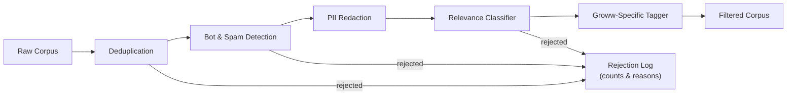
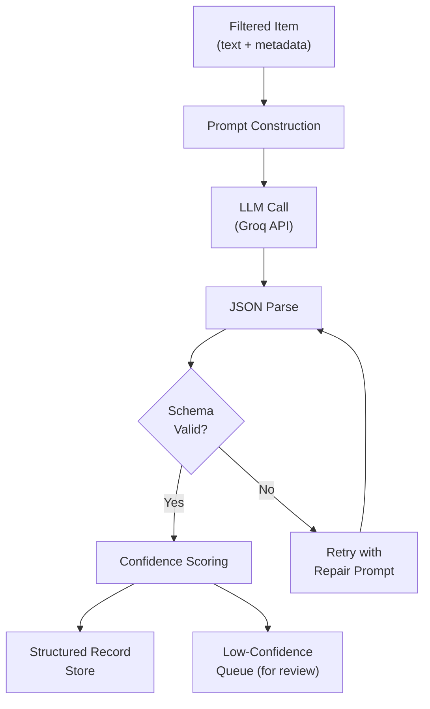
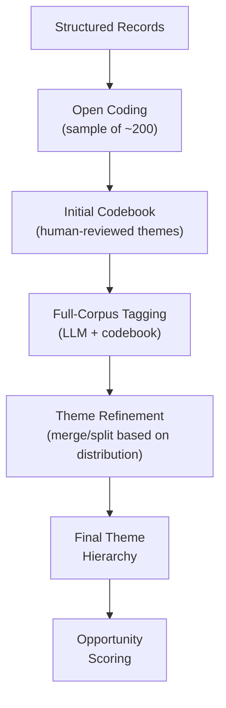
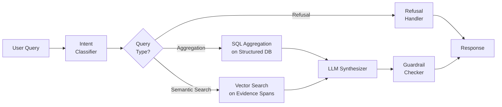
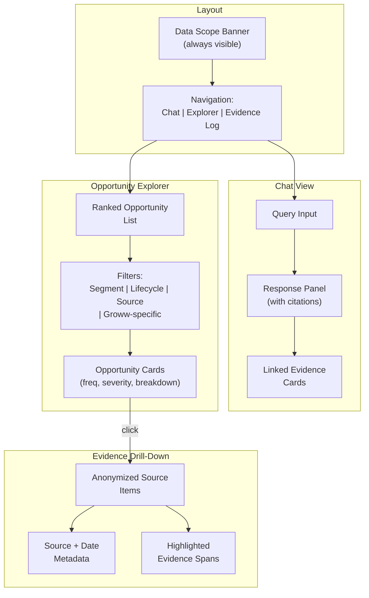
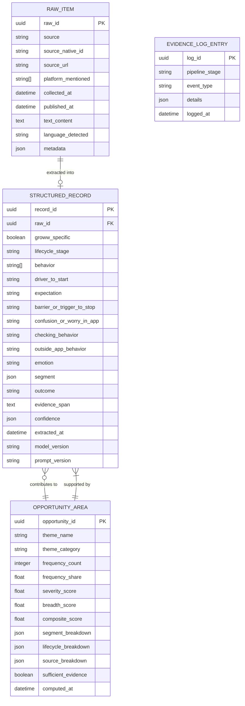
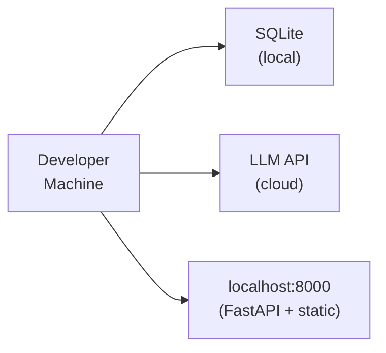
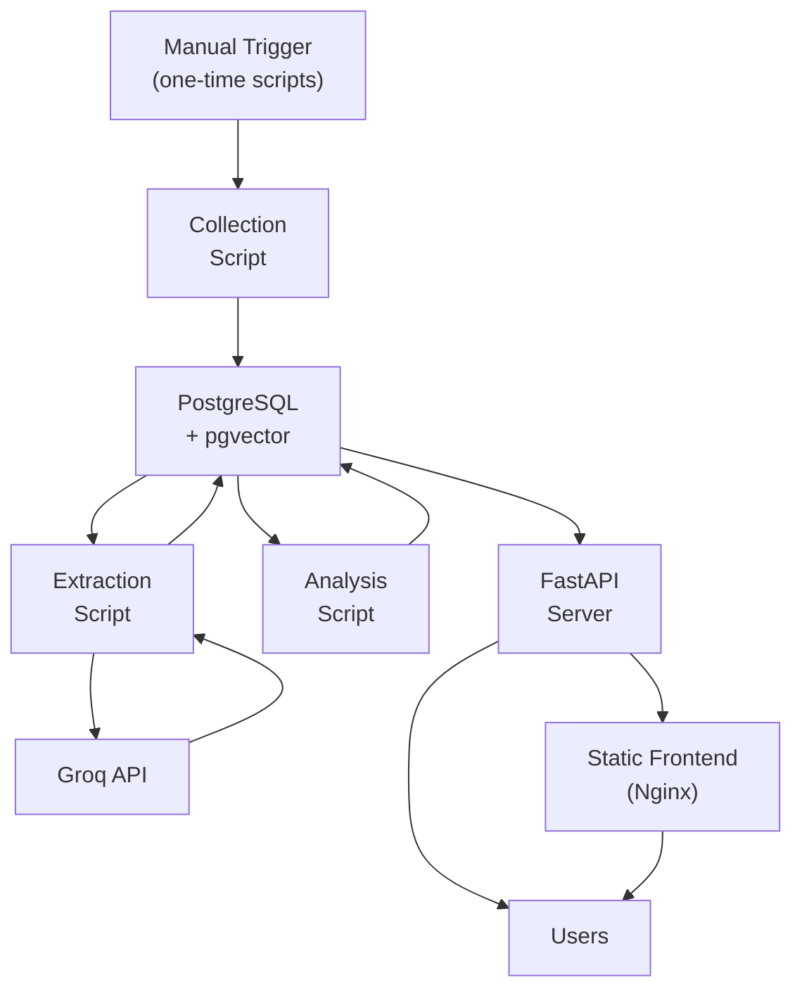
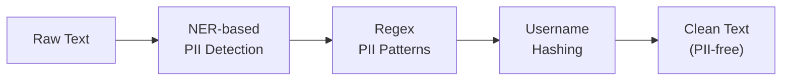

# Architecture: SIP Retention Discovery Engine

> Detailed technical architecture for a structured-extraction-based discovery engine that surfaces why first-time mutual fund investors in India pause, reduce, or let lapse their SIPs — with Groww as the reference product context.

---

## Table of Contents

1. [System Overview](#system-overview)
2. [High-Level Architecture Diagram](#high-level-architecture-diagram)
3. [Pipeline Stages](#pipeline-stages)
   - [Stage 1 — Data Collection](#stage-1--data-collection)
   - [Stage 2 — Preprocessing & Filtering](#stage-2--preprocessing--filtering)
   - [Stage 3 — Structured Extraction (LLM)](#stage-3--structured-extraction-llm)
   - [Stage 4 — Theme Clustering & Opportunity Scoring](#stage-4--theme-clustering--opportunity-scoring)
   - [Stage 5 — Synthesis & Query Engine](#stage-5--synthesis--query-engine)
   - [Stage 6 — User Interface](#stage-6--user-interface)
4. [Data Model](#data-model)
5. [Component Design](#component-design)
6. [API Contracts](#api-contracts)
7. [Technology Stack](#technology-stack)
8. [Infrastructure & Deployment](#infrastructure--deployment)
9. [Privacy, Safety & Guardrails](#privacy-safety--guardrails)
10. [AI Evidence Log Architecture](#ai-evidence-log-architecture)
11. [Scalability & Performance](#scalability--performance)
12. [Known Limitations & Bias Handling](#known-limitations--bias-handling)

---

## System Overview

The SIP Discovery Engine is a **one-shot, LLM-augmented research pipeline** with a lightweight query/UI layer on top. It is **not** a real-time or recurring product — there is no scheduler, orchestrator, or recurring pipeline. Data is collected once as a static snapshot, processed through extraction and analysis stages, and the resulting corpus is served via a web interface and chat endpoint.

### Design Principles

| Principle | How It Manifests |
|---|---|
| **Evidence over opinion** | Every finding traces back to counted, source-linked records |
| **Structured over free-text** | LLM extraction produces validated JSON, not prose summaries |
| **Quantified over qualitative** | Opportunity areas carry frequency, severity, and corpus share |
| **Segment-aware** | All aggregations can be sliced by segment, lifecycle stage, and source |
| **Transparent** | AI Evidence Log, bias banners, and data-scope metadata are first-class citizens |
| **Boundary-safe** | Refusal guardrails are enforced at extraction, synthesis, and UI layers |

---

## High-Level Architecture Diagram

```mermaid
graph TB
    subgraph "Data Collection Layer"
        S1["App Store\nReviews"]
        S2["Play Store\nReviews"]
        S3["Reddit API\n(r/IndiaInvestments,\nr/mutualfunds, etc.)"]
        S4["YouTube Data API\n(Comments)"]
        S5["Forum Scrapers\n(TradingQnA,\nValue Research)"]
        S6["Quora Q&As\n(Web & Curated)"]
        S7["X/Twitter\nDiscussions"]
        S8["Curated Multi-Channel\nRaw Datasets"]
    end

    subgraph "Ingestion & Preprocessing"
        COL["One-Time\nCollection Runner"]
        DEDUP["Deduplication\n& Bot Filtering"]
        PII["PII Redaction\n& Anonymization"]
        REL["Relevance Filter\n(SIP / first-time investor)"]
        TAG["Groww-Specific\nTagger"]
    end

    subgraph "Structured Extraction"
        LLM["LLM Extraction\nEngine"]
        VAL["Schema Validator\n(JSON)"]
        CONF["Confidence\nScorer"]
        GOLD["Gold-Sample\nQuality Check"]
    end

    subgraph "Analysis & Scoring"
        CLUST["Theme\nClustering"]
        OPP["Opportunity\nScorer"]
        SEG["Segment\nAggregator"]
        COMP["Continuer vs.\nDropper Comparator"]
    end

    subgraph "Storage"
        RAW["Raw Corpus\nStore"]
        STRUCT["Structured\nRecords DB"]
        OPP_DB["Opportunity\nAreas DB"]
        LOG_DB["AI Evidence\nLog Store"]
    end

    subgraph "Query & Serving Layer"
        QE["Query Engine\n(SQL + Vector)"]
        CHAT_BE["Chat Backend\n(RAG)"]
        API["REST / GraphQL\nAPI"]
    end

    subgraph "User Interface"
        BANNER["Data Scope\nBanner"]
        EXPLORER["Opportunity\nExplorer"]
        DRILL["Evidence\nDrill-Down"]
        CHAT_UI["Chat\nInterface"]
    end

    S1 & S2 & S3 & S4 & S5 & S6 & S7 & S8 --> COL
    COL --> RAW
    RAW --> DEDUP --> PII --> REL --> TAG
    TAG --> LLM
    LLM --> VAL --> CONF
    CONF --> STRUCT
    CONF --> GOLD
    GOLD --> LOG_DB
    STRUCT --> CLUST --> OPP --> OPP_DB
    STRUCT --> SEG
    STRUCT --> COMP
    SEG & COMP --> OPP_DB
    OPP_DB & STRUCT --> QE
    QE --> CHAT_BE --> API
    QE --> API
    API --> BANNER & EXPLORER & DRILL & CHAT_UI
    LOG_DB --> API
```



---

## Pipeline Stages

### Stage 1 — Data Collection

**Purpose:** Gather a one-time snapshot of public conversations about SIPs and first-time investing in India from all target sources. There is no scheduler, orchestrator, or recurring pipeline — collection scripts are run once manually.

#### Source Connectors

| Source | Collection Method | Key Parameters | Rate Limiting |
|---|---|---|---|
| **App Store** | RSS feed / iTunes Search API (`app-store-scraper`) | App ID for Groww, recent reviews | Per Apple TOS |
| **Play Store** | `google-play-scraper` (compliant) | App ID for Groww, balanced sampling across scores 1–5 (`Sort.MOST_RELEVANT`) | Respectful delays |
| **Reddit** | Reddit API (OAuth2 via `praw`) + local dump fallback | Subreddits: `IndiaInvestments`, `personalfinanceindia`, `IndianStreetBets`, `mutualfunds`; search queries: "SIP", "stopped SIP", "first SIP" | 60 req/min (OAuth) |
| **YouTube** | YouTube Data API v3 | Video search: "SIP returns", "SIP not working", "SIP beginners India"; comment threads | 10,000 units/day |
| **Forums** | Discourse API + Value Research RSS | TradingQnA, Value Research | Robots.txt + delays |
| **Quora** | HTML / Schema.org JSON-LD scraping + local raw fallback | Queries: "Groww SIP review", "SIP stopped Groww", "why stop SIP" | Polite delays |
| **X/Twitter** | X API v2 / curated thread complaints | Keywords: "SIP stopped", "Groww SIP", "mutual fund beginner" | Per tier limits |
| **Curated Raw Data** | Multi-channel raw parser (`raw_data/raw_data.txt`) | 300 curated feedback items from Reddit, Quora, Play Store, YouTube, Twitter, App Store | Local file ingest |

#### One-Time Collection Runner

```
┌─────────────────────────────────────────────────────┐
│          One-Time Collection Script                  │
│       Run manually: python run_collection.py        │
├─────────────────────────────────────────────────────┤
│  For each source connector:                         │
│    1. Fetch all available items (within date range) │
│    2. Normalize to RawItem schema                   │
│    3. Write to Raw Corpus Store                     │
│    4. Log collection metadata to AI Evidence Log    │
└─────────────────────────────────────────────────────┘
```

#### RawItem Schema

```json
{
  "raw_id": "uuid-v4",
  "source": "reddit | playstore | appstore | youtube | forum | twitter | quora | other",
  "source_native_id": "original post/review ID or URL",
  "source_url": "https://...",
  "platform_mentioned": ["groww", "zerodha", "none", ...],
  "collected_at": "ISO-8601",
  "published_at": "ISO-8601",
  "text": "original text content",
  "language_detected": "en | hi | hinglish | other",
  "metadata": {
    "subreddit": "...",
    "rating": 3,
    "video_id": "...",
    "thread_title": "...",
    "extra": {}
  }
}
```

---

### Stage 2 — Preprocessing & Filtering

**Purpose:** Clean, deduplicate, anonymize, and filter the raw corpus to retain only relevant, high-quality items.

#### Sub-steps



1. **Deduplication**
   - Exact-match hash on normalized text
   - Near-duplicate detection via MinHash / SimHash (threshold ≥ 0.85 similarity)
   - Cross-source dedup (same user post shared on Reddit and a forum)

2. **Bot & Spam Detection**
   - Heuristic filters: repeated text patterns, promotional URLs, review-bombing cadence
   - Lightweight classifier trained on labeled spam samples
   - All filtered items are **counted** (not silently dropped) and logged

3. **PII Redaction**
   - Named-entity recognition for person names, phone numbers, PAN, bank account numbers, email addresses
   - Regex patterns for Indian PII formats (PAN: `[A-Z]{5}[0-9]{4}[A-Z]`, phone: `+91...`)
   - Usernames hashed with SHA-256 + salt; original never stored post-ingestion

4. **Relevance Classifier**
   - Binary classifier: Is this about SIP / first-time mutual fund investing?
   - LLM-based zero-shot or fine-tuned on a small labeled set (~200 items)
   - Threshold tuned for **high recall** (err on the side of inclusion; irrelevant items are cheaper to discard later than to miss)

5. **Groww-Specific Tagger**
   - `groww_specific = true` if text mentions "Groww" (case-insensitive, accounting for transliterations)
   - `groww_specific = false` for platform-agnostic SIP discussions
   - Posts about **other** specific platforms (Zerodha, Coin, Kuvera, etc.) without Groww mention → **excluded**

#### Filtering Metrics (logged after collection)

| Metric | Example |
|---|---|
| `total_collected` | 12,400 |
| `duplicates_removed` | 1,230 |
| `spam_bot_removed` | 340 |
| `pii_items_redacted` | 890 |
| `irrelevant_removed` | 3,200 |
| `competitor_only_removed` | 1,100 |
| `corpus_retained` | 6,530 |

---

### Stage 3 — Structured Extraction (LLM)

**Purpose:** Transform each filtered item into a validated, structured JSON record containing behavioral signals.

#### Extraction Pipeline



#### Prompt Design

The extraction prompt follows a structured template:

```
SYSTEM: You are a structured data extractor for Indian mutual fund investor 
conversations. Extract behavioral signals from the text. Output valid JSON 
matching the schema exactly. If the text does not support a field, use "unknown". 
Never guess or fabricate.

SCHEMA: [full JSON schema with field descriptions and allowed values]

RULES:
- Only extract what the text explicitly states or strongly implies
- Use "unknown" for any field lacking textual evidence
- Include a short verbatim excerpt (≤30 words) in evidence_span
- Rate your confidence per field: high / medium / low / unknown

USER: 
Source: {source}
Date: {published_at}
Text: "{text}"
```

#### Schema Validation

- **JSON Schema validation** via `jsonschema` / Pydantic models
- **Enum enforcement**: lifecycle_stage, emotion, outcome fields checked against allowed values
- **Evidence span check**: evidence_span must be a substring (or close match) of the original text
- **Failed validations** → retry with a repair prompt (max 2 retries), then flag for manual review

#### Extraction Record Schema

```json
{
  "record_id": "uuid-v4",
  "raw_id": "FK to RawItem",
  "groww_specific": true,
  "lifecycle_stage": "months 2 to 3",
  "behavior": ["checks returns frequently", "seeks outside advice"],
  "driver_to_start": "peer/influencer",
  "expectation": "15% annual returns in 1 year",
  "barrier_or_trigger_to_stop": "low or negative returns",
  "confusion_or_worry_in_app": "XIRR",
  "checking_behavior": "daily NAV check",
  "outside_app_behavior": "YouTube, Reddit",
  "emotion": "anxiety",
  "segment": {
    "income_stability": "stable",
    "age_band": "22-28",
    "source_of_money": "salary",
    "influencer": "finfluencer"
  },
  "outcome": "paused",
  "evidence_span": "I started SIP after watching a YouTube video but returns were -2% after 3 months so I paused",
  "confidence": {
    "lifecycle_stage": "high",
    "behavior": "high",
    "driver_to_start": "medium",
    "expectation": "medium",
    "barrier_or_trigger_to_stop": "high",
    "confusion_or_worry_in_app": "low",
    "checking_behavior": "medium",
    "outside_app_behavior": "high",
    "emotion": "high",
    "segment": "low",
    "outcome": "high"
  },
  "extracted_at": "ISO-8601",
  "model_version": "llama-3.3-70b-versatile",
  "prompt_version": "v2.3"
}
```

#### Batch Processing Strategy

| Parameter | Value |
|---|---|
| Batch size | 50 items per batch (single-item extraction per LLM call) |
| Parallelism | 10 concurrent requests (within Groq rate limits — 30 req/min on free tier, higher on paid) |
| Retry policy | 2 retries with exponential backoff |
| Cost tracking | Token usage logged for Evidence Log |
| Model | Groq: `llama-3.3-70b-versatile` (primary), `mixtral-8x7b-32768` (fallback for high-volume / lower-complexity items) |

---

### Stage 4 — Theme Clustering & Opportunity Scoring

**Purpose:** Group extracted signals into thematic opportunity areas, score them, and enable segment-aware comparison.

#### Theme Discovery Process



#### Theme Hierarchy (Example)

```
Opportunity Areas
├── Returns Disappointment
│   ├── Unrealistic return expectations
│   ├── Negative short-term returns
│   └── Confusion between absolute and XIRR
├── Trust & Confidence Erosion
│   ├── Market volatility fear
│   ├── "Is my money safe?"
│   └── Platform distrust
├── Lifecycle Friction
│   ├── Forgotten/lapsed mandate
│   ├── Autopay failure
│   └── Pause vs. cancel confusion
├── Income & Expense Pressure
│   ├── Income disruption
│   ├── Expense spike
│   └── SIP amount too high for budget
├── Knowledge & Guidance Gap
│   ├── No progress visibility
│   ├── Confusing statements/metrics
│   └── Seeking outside validation
└── Emotional Disengagement
    ├── Indifference / forgotten SIP
    ├── Regret about starting
    └── FOMO on other investments
```

#### Opportunity Scoring Model

Each opportunity area receives a composite score:

```
opportunity_score = w₁ × frequency_score + w₂ × severity_score + w₃ × breadth_score
```

| Component | Calculation | Weight (default) |
|---|---|---|
| **Frequency Score** | `count / total_corpus_size` — normalized share of corpus mentioning this theme | w₁ = 0.4 |
| **Severity Score** | Proportion of items in this theme where `outcome ∈ {paused, reduced, stopped}` — i.e., how directly the theme precedes negative outcomes | w₂ = 0.4 |
| **Breadth Score** | Number of distinct sources and segments where the theme appears (penalizes single-source or single-segment themes) | w₃ = 0.2 |

All scores are normalized to [0, 1] and weights are configurable.

#### Segment Aggregation

Every opportunity area is sliceable by:

- **Lifecycle stage**: pre-start → month 0–1 → months 2–3 → months 4–6 → months 7–12 → 12+ → lapsed/restarted
- **Segment dimensions**: income stability, age band, source of money, influencer
- **Source**: Play Store, Reddit, YouTube, etc.
- **Groww-specific** vs. platform-agnostic

#### Continuer vs. Dropper Comparator

A dedicated analysis module compares records where `outcome = continued` against records where `outcome ∈ {paused, reduced, stopped}`:

| Dimension | Continuer Profile | Dropper Profile |
|---|---|---|
| Top drivers to start | _(computed)_ | _(computed)_ |
| Dominant emotions | _(computed)_ | _(computed)_ |
| Checking behavior | _(computed)_ | _(computed)_ |
| Outside-app behavior | _(computed)_ | _(computed)_ |
| Top confusions | _(computed)_ | _(computed)_ |

Output: statistical comparison (chi-squared or Fisher's exact for categorical fields) with effect sizes.

---

### Stage 5 — Synthesis & Query Engine

**Purpose:** Power the chat interface and opportunity explorer with a query engine that retrieves, aggregates, and synthesizes evidence-backed answers.

#### Query Engine Architecture



#### Intent Classification

| Intent | Example Query | Handling |
|---|---|---|
| `count_query` | "How many investors mentioned autopay failure?" | SQL aggregation |
| `comparison_query` | "Compare continuers vs droppers on checking behavior" | SQL + cross-tab |
| `exploration_query` | "What worries first-time investors in months 2–3?" | Vector search + aggregation |
| `drill_down` | "Show me evidence for 'returns disappointment'" | Retrieve evidence spans |
| `refusal` | "Which fund should I invest in?" | Polite decline + redirect |

#### Synthesis Prompt (Chat)

```
SYSTEM: You are a research analyst answering questions about SIP investor 
behavior. You have access to a structured dataset of {N} tagged conversations 
from {sources} collected between {date_range}.

RULES:
- Always cite counts: "X out of Y items (Z%) mention..."
- Always specify the source mix and segment breakdown
- If evidence is below 30 items or from <2 sources, label as 
  "directional only — insufficient evidence"
- NEVER recommend funds, stocks, or AMCs
- NEVER use fear, FOMO, or urgency framing
- If asked for investment advice, decline politely and redirect 
  to what the corpus can answer
```

---

### Stage 6 — User Interface

**Purpose:** Provide a minimal but functional web interface for exploring findings.

#### UI Components



#### Data Scope Banner (persistent)

```
╔═══════════════════════════════════════════════════════════════════════╗
║  Based on 6,530 public conversations from 7 sources                  ║
║  Collected: Jan 2026 – Oct 2026  |  Last updated: 18 Oct 2026       ║
║  ⚠ Known biases: review-site complaint skew, Reddit urban/male skew ║
╚═══════════════════════════════════════════════════════════════════════╝
```

---

## Data Model

### Entity-Relationship Diagram



### Storage Layer

| Store | Technology | Purpose |
|---|---|---|
| **Raw Corpus** | SQLite (dev) / PostgreSQL (prod) | Immutable archive of collected items |
| **Structured Records** | SQLite (dev) / PostgreSQL (prod) | Tagged extraction outputs, primary analytical store |
| **Opportunity Areas** | Same DB, separate table | Pre-computed scored themes |
| **Vector Store** | ChromaDB / pgvector | Embeddings of evidence spans for semantic search |
| **AI Evidence Log** | JSON files + DB table | Audit trail of pipeline runs |
| **File Exports** | Parquet / CSV | For external analysis and deliverable |

---

## Component Design

### Directory Structure

```
sip-discovery-engine/
├── docs/
│   ├── context.md
│   ├── architecture.md
│   ├── research-findings-summary.md   # Auto-generated by analysis pipeline
│   └── ai-evidence-log/
│       └── YYYY-MM-DD_run.md
├── src/
│   ├── collectors/             # Stage 1: Source connectors
│   │   ├── base_collector.py
│   │   ├── reddit_collector.py
│   │   ├── playstore_collector.py
│   │   ├── appstore_collector.py
│   │   ├── youtube_collector.py
│   │   ├── forum_collector.py
│   │   ├── quora_collector.py
│   │   ├── raw_data_collector.py
│   │   └── twitter_collector.py
│   ├── preprocessing/          # Stage 2: Filtering pipeline
│   │   ├── deduplicator.py
│   │   ├── spam_detector.py
│   │   ├── pii_redactor.py
│   │   ├── relevance_classifier.py
│   │   └── groww_tagger.py
│   ├── extraction/             # Stage 3: LLM extraction
│   │   ├── extractor.py
│   │   ├── prompts/
│   │   │   ├── extraction_v1.txt
│   │   │   └── extraction_v2.txt
│   │   ├── schema_validator.py
│   │   └── confidence_scorer.py
│   ├── analysis/               # Stage 4: Clustering & scoring
│   │   ├── theme_clusterer.py
│   │   ├── opportunity_scorer.py
│   │   ├── segment_aggregator.py
│   │   └── continuer_dropper_comparator.py
│   ├── query/                  # Stage 5: Query engine
│   │   ├── query_engine.py
│   │   ├── intent_classifier.py
│   │   ├── sql_builder.py
│   │   ├── vector_search.py
│   │   ├── synthesizer.py
│   │   └── guardrails.py
│   ├── api/                    # API layer
│   │   ├── app.py
│   │   ├── routes/
│   │   │   ├── chat.py
│   │   │   ├── opportunities.py
│   │   │   ├── evidence.py
│   │   │   └── metadata.py
│   │   └── middleware/
│   │       └── refusal_middleware.py
│   ├── ui/                     # Stage 6: Frontend
│   │   ├── index.html
│   │   ├── css/
│   │   ├── js/
│   │   └── components/
│   ├── models/                 # Data models
│   │   ├── schemas.py          # Unified Pydantic models & enums
│   │   ├── raw_item.py
│   │   ├── structured_record.py
│   │   ├── opportunity_area.py
│   │   └── evidence_log.py
│   ├── db/                     # Database layer
│   │   ├── connection.py
│   │   ├── migrations/
│   │   └── queries/
│   └── utils/                  # Shared utilities
│       ├── config.py
│       ├── logging.py
│       └── groq_client.py
├── scripts/
│   ├── run_collection.py
│   ├── run_preprocessing.py
│   ├── export_review_data.py
│   ├── run_extraction.py
│   ├── run_analysis.py
│   ├── generate_findings.py       # Generates research-findings-summary.md
│   ├── export_dataset.py
│   └── validate_gold_sample.py
├── data/
│   ├── raw/                    # Raw collected data
│   ├── processed/              # Filtered & extracted
│   ├── gold_sample/            # Human-labeled validation set
│   └── exports/                # Parquet/CSV deliverables
├── tests/
│   ├── test_collectors/
│   ├── test_preprocessing/
│   ├── test_extraction/
│   ├── test_analysis/
│   └── test_guardrails/
├── config/
│   ├── sources.yaml            # Source connector configs
│   ├── extraction.yaml         # LLM model & prompt configs
│   ├── scoring.yaml            # Opportunity scoring weights
│   └── guardrails.yaml         # Refusal rules & thresholds
├── requirements.txt
├── pyproject.toml
└── README.md
```

### Key Component Interfaces

#### BaseCollector (Abstract)

```python
class BaseCollector(ABC):
    """Base class for all source connectors. One-time collection only."""
    
    @abstractmethod
    def collect_snapshot(self) -> list[RawItem]:
        """Collect all available items from the source (one-time snapshot)."""
        ...
    
    @abstractmethod
    def get_source_name(self) -> str:
        """Return the canonical source name."""
        ...
    
    def respect_rate_limit(self):
        """Enforce rate limiting per source TOS."""
        ...
```

#### Extractor

```python
class StructuredExtractor:
    """LLM-based structured extraction engine."""
    
    def extract(self, item: FilteredItem) -> StructuredRecord:
        """Extract structured fields from a single item."""
        ...
    
    def extract_batch(self, items: list[FilteredItem]) -> list[StructuredRecord]:
        """Process a batch of items with concurrency control."""
        ...
    
    def validate(self, record: dict) -> tuple[bool, list[str]]:
        """Validate extracted JSON against schema. Returns (valid, errors)."""
        ...
```

#### OpportunityScorer

```python
class OpportunityScorer:
    """Scores and ranks opportunity areas."""
    
    def compute_scores(
        self, 
        records: list[StructuredRecord],
        themes: list[Theme],
        weights: ScoringWeights
    ) -> list[OpportunityArea]:
        """Compute composite scores for each theme."""
        ...
    
    def rank(self, areas: list[OpportunityArea]) -> list[OpportunityArea]:
        """Return opportunity areas sorted by composite score, descending."""
        ...
    
    def flag_insufficient_evidence(self, area: OpportunityArea) -> bool:
        """Flag if area has < 30 items or < 2 sources."""
        ...
```

---

## API Contracts

### REST API Endpoints

#### `GET /api/v1/metadata`
Returns data scope information for the banner.

```json
{
  "total_items": 6530,
  "sources": ["playstore", "reddit", "youtube", "appstore", "forum", "twitter"],
  "date_range": { "start": "2026-01-15", "end": "2026-10-18" },
  "last_updated": "2026-10-18T14:30:00Z",
  "groww_specific_count": 2840,
  "platform_agnostic_count": 3690,
  "known_biases": [
    "Review-site skew toward complaints",
    "Reddit skew toward urban/male/finance-literate users",
    "Survivorship bias in lapsed users who stop posting"
  ]
}
```

#### `GET /api/v1/opportunities`
Returns ranked opportunity areas, with optional filters.

**Query params:** `segment`, `lifecycle_stage`, `source`, `groww_specific`, `min_evidence`, `sort_by`, `limit`

```json
{
  "opportunities": [
    {
      "opportunity_id": "...",
      "theme": "Returns Disappointment — Unrealistic Expectations",
      "category": "Returns Disappointment",
      "frequency": { "count": 482, "share": 0.074 },
      "severity_score": 0.82,
      "breadth_score": 0.91,
      "composite_score": 0.78,
      "sufficient_evidence": true,
      "segment_breakdown": { ... },
      "lifecycle_breakdown": { ... },
      "source_breakdown": { ... }
    }
  ],
  "total": 24,
  "filters_applied": { ... }
}
```

#### `GET /api/v1/opportunities/{id}/evidence`
Returns anonymized source items supporting an opportunity area.

```json
{
  "opportunity_id": "...",
  "theme": "...",
  "evidence_items": [
    {
      "record_id": "...",
      "source": "reddit",
      "published_at": "2026-07-12",
      "evidence_span": "...",
      "lifecycle_stage": "months 2 to 3",
      "outcome": "paused",
      "emotion": "disappointment",
      "groww_specific": false
    }
  ],
  "total_items": 482,
  "page": 1,
  "per_page": 20
}
```

#### `POST /api/v1/chat`
Accepts a natural-language question, returns a synthesized answer with citations.

**Request:**
```json
{
  "query": "What confuses first-time SIP investors in their first 3 months?",
  "filters": {
    "lifecycle_stage": ["month 0 to 1", "months 2 to 3"],
    "groww_specific": null
  }
}
```

**Response:**
```json
{
  "answer": "Based on 1,240 items from the first 3 months...",
  "citations": [
    { "record_id": "...", "evidence_span": "...", "source": "reddit" }
  ],
  "corpus_stats": {
    "items_searched": 1240,
    "sources_represented": 5,
    "evidence_level": "sufficient"
  },
  "refusal": false
}
```

#### `GET /api/v1/evidence-log`
Returns AI Evidence Log entries for transparency.

---

## Technology Stack

| Layer | Technology | Rationale |
|---|---|---|
| **Language** | Python 3.11+ | Rich ecosystem for NLP, LLMs, data processing |
| **Web Framework** | FastAPI | Async, auto-docs (OpenAPI), Pydantic validation |
| **Database** | SQLite (dev) / PostgreSQL (prod) | Queryable structured store; pgvector for embeddings |
| **Vector Store** | ChromaDB (dev) / pgvector (prod) | Semantic search over evidence spans |
| **LLM Provider** | **Groq** — `llama-3.3-70b-versatile` (primary), `mixtral-8x7b-32768` (fallback) | Fast inference, structured extraction quality, cost-effective |
| **Embeddings** | BGE (`BAAI/bge-small-en-v1.5` or `bge-base-en-v1.5`) | Local embeddings — high-quality retrieval-optimized vectors, no external API dependency |
| **Frontend** | Vanilla HTML/CSS/JS | Minimal UI requirement; no framework overhead |
| **Data Export** | Pandas → Parquet/CSV | Deliverable dataset |
| **Testing** | pytest + hypothesis | Unit, integration, property-based tests |
| **Config** | YAML + environment variables | Source configs, model params, scoring weights |

> **Note:** There is no task scheduler (APScheduler, Cron, etc.) — the pipeline is run once as a one-time snapshot.

---

## Infrastructure & Deployment

### Development Setup



### Production Setup



> **No scheduler or orchestrator.** The collection, extraction, and analysis scripts are run once manually (or via a single `make run-pipeline` / `python run_all.py` command). Only the FastAPI server and static frontend run as long-lived services.

### Environment Configuration

```yaml
# config/sources.yaml
reddit:
  client_id: ${REDDIT_CLIENT_ID}
  client_secret: ${REDDIT_CLIENT_SECRET}
  subreddits:
    - IndiaInvestments
    - personalfinanceindia
    - IndianStreetBets
    - mutualfunds
  search_queries:
    - "SIP stopped"
    - "first SIP"
    - "SIP returns"
    - "SIP not working"
    - "Groww SIP"
  rate_limit_per_minute: 60

youtube:
  api_key: ${YOUTUBE_API_KEY}
  search_queries:
    - "SIP returns India"
    - "SIP not working"
    - "first mutual fund SIP"
    - "Groww review"
  max_results_per_query: 50
  quota_limit_daily: 10000

# ... other sources
```

---

## Privacy, Safety & Guardrails

### Privacy Pipeline



| PII Type | Detection Method | Action |
|---|---|---|
| Person names | NER (spaCy / Presidio) | Replace with `[PERSON]` |
| Phone numbers | Regex (`+91`, 10-digit) | Replace with `[PHONE]` |
| PAN | Regex (`[A-Z]{5}[0-9]{4}[A-Z]`) | Replace with `[PAN]` |
| Email | Regex | Replace with `[EMAIL]` |
| Bank account | Regex (long digit sequences) | Replace with `[ACCOUNT]` |
| Usernames | SHA-256 + salt | Hash; original never stored |

### Guardrail Enforcement Points

| Layer | Check | Action on Violation |
|---|---|---|
| **Extraction (Stage 3)** | LLM output must not contain fund recommendations | Strip and flag |
| **Synthesis (Stage 5)** | Response must not contain FOMO/urgency framing | Rewrite or block |
| **API Middleware** | All outgoing responses checked against refusal patterns | Return refusal response |
| **UI** | Chat input checked for investment-advice intent | Show polite redirect |

### Refusal Response Template

```json
{
  "answer": "I'm designed to surface research findings about investor behavior, not to recommend specific funds or investments. Based on the corpus, I can help you understand [related topic]. Would you like to explore that?",
  "refusal": true,
  "refusal_reason": "investment_recommendation_request"
}
```

### Evidence Threshold Enforcement

| Finding Level | Minimum Support | Label |
|---|---|---|
| **Headline finding** | n ≥ 30 items, ≥ 2 independent sources | _(no label needed)_ |
| **Supporting finding** | 10 ≤ n < 30 or single source | "Directional only" |
| **Anecdotal** | n < 10 | "Insufficient evidence" |

---

## AI Evidence Log Architecture

The AI Evidence Log is a first-class system component, not an afterthought.

### Log Structure

```
docs/ai-evidence-log/
├── collection/
│   └── YYYY-MM-DD_collection_run.md
├── extraction/
│   ├── prompt_versions.md
│   ├── model_versions.md
│   └── YYYY-MM-DD_extraction_run.md
├── quality/
│   ├── gold_sample_results.md
│   ├── inter_run_consistency.md
│   └── failure_cases.md
├── themes/
│   ├── codebook_v1.md
│   └── theme_evolution.md
└── corrections/
    └── error_log.md
```

### What Gets Logged

| Event | Logged Data |
|---|---|
| **Collection run** | Sources queried, date ranges, queries used, items collected, items retained after filtering, rejection reasons and counts |
| **Extraction run** | Model version, prompt version, items processed, schema validation pass/fail rate, average confidence scores, token usage, cost |
| **Quality check** | Gold sample size, per-field precision/recall/agreement, inter-run consistency (same items re-extracted, field match rate) |
| **Theme iteration** | Codebook version, themes added/merged/split, rationale |
| **Failure cases** | Sarcasm misclassified, Hinglish parsing failures, vague posts, with examples and resolution |
| **Corrections** | AI was wrong → what was changed and why |

---

## Scalability & Performance

### Current Scale Targets

| Dimension | Target |
|---|---|
| Corpus size | 5,000 – 50,000 items |
| Collection mode | One-time snapshot (no recurring cadence) |
| Extraction throughput | ~1,000–2,000 items/hour (Groq offers fast inference; limited by rate tier) |
| Query latency (chat) | < 5 seconds |
| Query latency (explorer) | < 2 seconds (pre-computed) |

### Scaling Strategies

- **Pre-computed aggregations**: Opportunity scores, segment breakdowns computed after the extraction run, cached in DB
- **Vector index**: Evidence spans embedded and indexed for fast semantic search
- **Batch extraction**: Items processed in batches with concurrency control to respect Groq rate limits

---

## Known Limitations & Bias Handling

### Source Biases (must be surfaced in all outputs)

| Bias | Description | Mitigation |
|---|---|---|
| **Complaint skew** | App store reviews over-represent negative experiences | Report source mix alongside every finding; weight analysis by source diversity |
| **Reddit demographic skew** | Urban, male, finance-literate, English-speaking over-represented | Surface demographic caveat; track segment confidence |
| **Survivorship bias** | Lapsed users stop posting — their silence is invisible | Explicitly note that "stopped posting" ≠ "satisfied"; flag findings about lapsing as potentially under-counted |
| **Language coverage** | Hinglish / regional language posts may be misclassified | Track language distribution; flag extraction confidence on non-English items |
| **Temporal skew** | Market conditions at collection time influence sentiment | Record market context (e.g. recent crash/rally) alongside collection date |

### System Limitations

- **No causal inference**: The system identifies correlations and patterns, not causation
- **No internal Groww data**: Cannot validate findings against actual retention metrics
- **LLM extraction is probabilistic**: Quality depends on prompt engineering and Groq model capability (LLaMA 3.3 70B); the gold sample is the primary quality gate
- **Public data only**: Private conversations (DMs, closed groups) are invisible to the system

---

> **Next steps:** See [context.md](file:///c:/Users/rparv/.antigravity-ide/SIP%20Discovery%20Engine/docs/context.md) for the full problem statement and [README.md](file:///c:/Users/rparv/.antigravity-ide/SIP%20Discovery%20Engine/README.md) for setup instructions.
