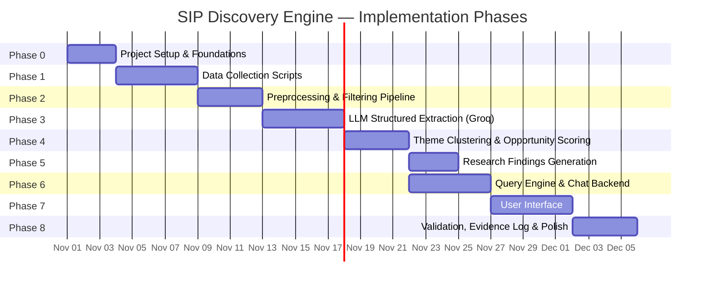
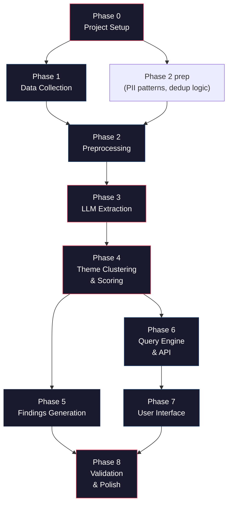

# Implementation Plan: SIP Retention Discovery Engine

> Phase-wise implementation plan derived from [architecture.md](file:///c:/Users/rparv/.antigravity-ide/SIP%20Discovery%20Engine/docs/architecture.md) and [context.md](file:///c:/Users/rparv/.antigravity-ide/SIP%20Discovery%20Engine/docs/context.md). This is a one-time snapshot pipeline (no scheduler/orchestrator) using Groq for LLM inference and BGE for embeddings.

---

## Implementation Overview



---

## Phase 0 — Project Setup & Foundations

**Goal:** Establish the project skeleton, tooling, config, database schema, and data models so all subsequent phases build on a stable base.

**Duration:** ~2–3 days

### Tasks

| # | Task | Output | Done When |
|---|---|---|---|
| 0.1 | Initialize project directory structure (as defined in architecture) | `sip-discovery-engine/` skeleton | All folders and `__init__.py` files exist |
| 0.2 | Set up `pyproject.toml` / `requirements.txt` with core dependencies | Dependency manifest | `pip install -e .` succeeds |
| 0.3 | Create `config/` YAML files: `sources.yaml`, `extraction.yaml`, `scoring.yaml`, `guardrails.yaml` | Config templates with env-var placeholders | Configs load without error |
| 0.4 | Set up `.env` template for API keys (Groq, Reddit, YouTube, etc.) | `.env.example` | All required keys documented |
| 0.5 | Implement `src/models/` — Pydantic models for `RawItem`, `StructuredRecord`, `OpportunityArea`, `EvidenceLogEntry` | Data models | Models pass validation tests |
| 0.6 | Implement `src/db/connection.py` — SQLite database initialization + schema migrations | DB layer | `python -c "from src.db.connection import init_db; init_db()"` creates tables |
| 0.7 | Implement `src/utils/config.py` — YAML + env-var config loader | Config utility | Configs accessible app-wide |
| 0.8 | Implement `src/utils/logging.py` — Structured logging setup | Logging utility | Log output with timestamps and levels |
| 0.9 | Implement `src/utils/groq_client.py` — Groq API client wrapper with rate limiting and retry | Groq client | Can make a test completion call |
| 0.10 | Write initial tests for models and DB | `tests/` scaffolding | `pytest` passes |

### Key Dependencies

```
groq                    # Groq Python SDK
pydantic>=2.0           # Data validation
pyyaml                  # Config files
python-dotenv           # Environment variables
sqlite3                 # (stdlib) Database
pytest                  # Testing
```

### Exit Criteria
- [ ] `pip install -e .` succeeds
- [ ] Database initializes with all 4 tables (raw_items, structured_records, opportunity_areas, evidence_log)
- [ ] Groq client makes a successful test call
- [ ] `pytest` passes on model and DB tests

---

## Phase 1 — Data Collection Scripts

**Goal:** Build one-time collection scripts for each source. Each script fetches a snapshot of public conversations and normalizes them into `RawItem` records.

**Duration:** ~4–5 days

### Tasks

| # | Task | Output | Done When |
|---|---|---|---|
| 1.1 | Implement `src/collectors/base_collector.py` — abstract `BaseCollector` with `collect_snapshot()`, `get_source_name()`, `respect_rate_limit()` | Base class | Subclasses can inherit |
| 1.2 | Implement `src/collectors/playstore_collector.py` — Groww Play Store reviews | Play Store connector | Reviews fetched and normalized to `RawItem` |
| 1.3 | Implement `src/collectors/appstore_collector.py` — Groww App Store reviews | App Store connector | Reviews fetched and normalized |
| 1.4 | Implement `src/collectors/reddit_collector.py` — Reddit API (OAuth2) for target subreddits + search queries | Reddit connector | Posts + comments fetched from r/IndiaInvestments, r/mutualfunds, etc. |
| 1.5 | Implement `src/collectors/youtube_collector.py` — YouTube Data API v3 for video comments | YouTube connector | Comments fetched from SIP-related videos |
| 1.6 | Implement `src/collectors/forum_collector.py` — TradingQnA, Value Research (compliant scraping / RSS) | Forum connector | Forum threads fetched |
| 1.7 | Implement `src/collectors/twitter_collector.py` — X API v2 (if API terms allow) | Twitter connector | Tweets fetched (or gracefully skipped if API unavailable) |
| 1.7b | Implement `src/collectors/quora_collector.py` — Quora search & discussion collector | Quora connector | Quora Q&As and answers fetched |
| 1.7c | Implement `src/collectors/raw_data_collector.py` — Manual raw data ingestion (`raw_data/raw_data.txt`) | Raw data parser | 300 curated multi-channel items parsed & normalized |
| 1.8 | Implement `scripts/run_collection.py` — orchestrates all collectors, writes to DB, logs metadata | Collection runner | `python scripts/run_collection.py` populates raw_items table |
| 1.9 | Write tests for each collector (mock API responses) | Collector tests | `pytest tests/test_collectors/` passes |

### Source Priority Order

Build in this order (highest-value sources first):

1. **Play Store** — highest volume of Groww-specific reviews
2. **Reddit** — richest qualitative data, multi-subreddit
3. **YouTube** — SIP explainer comments are highly behavioral
4. **App Store** — complements Play Store
5. **Forums** — niche but high-quality investor discussions
6. **Quora** — high-intent user Q&As on SIP returns, mandate bounce, and app trust
7. **Twitter** — lowest priority; API access may be limited

### Key Decisions

| Decision | Choice | Rationale |
|---|---|---|
| Play Store method | `google-play-scraper` (Python package) | Compliant, no API key needed, well-maintained |
| Reddit method | Reddit API via `praw` + local raw fallback | Official API, OAuth2, respects rate limits, manual dump support |
| YouTube method | YouTube Data API v3 via REST endpoints | Official API, 10K units/day quota, full comment threads |
| Forum method | Discourse JSON API + Value Research RSS | Open endpoints, rich investor discussions |
| Quora method | Public HTML/JSON-LD scraping + local raw dump | Captures high-intent Q&A discussions with anti-bot resilience |
| Collection date range | Last 12–18 months from run date | Matches investor scope (SIPs in first 12–18 months) |

### Exit Criteria
- [x] At least 4 of 7 source collectors working (Play Store, App Store, Reddit, YouTube, Forum, Quora, and Multi-Channel Raw Data active; 5,268 raw items collected)
- [x] `run_collection.py` populates `raw_items` table
- [x] Each item has: source, source_native_id, source_url, published_at, text, platform_mentioned
- [x] Collection metadata logged to AI Evidence Log
- [x] Full collector test suite passing (all 94 tests green)

---

## Phase 2 — Preprocessing & Filtering Pipeline

**Goal:** Clean, deduplicate, anonymize, and filter the raw corpus across all 7 active channels (Play Store, App Store, Reddit, YouTube, Forums, Quora, Twitter/X). Tag items as Groww-specific or platform-agnostic. Reject irrelevant, spam, and competitor-only content.

**Duration:** ~3–4 days

### Tasks

| # | Task | Output | Done When |
|---|---|---|---|
| 2.1 | Implement `src/preprocessing/deduplicator.py` — exact-hash + near-duplicate detection (SimHash + Jaccard token overlap) | Deduplication module | Duplicate items flagged and counted |
| 2.2 | Implement `src/preprocessing/spam_detector.py` — heuristic filters for bots, promotional spam, short spam | Spam detector | Spam items flagged and counted |
| 2.3 | Implement `src/preprocessing/pii_redactor.py` — regex + mask redaction (names, phone, PAN, email, bank accounts); username hashing | PII redactor | No PII in processed text; usernames hashed |
| 2.4 | Implement `src/preprocessing/relevance_classifier.py` — Fast-path SIP keywords + trading exclusion + App store investment terms + Groq zero-shot LLM evaluation | Relevance filter | Irrelevant items filtered with high recall |
| 2.5 | Implement `src/preprocessing/groww_tagger.py` — tag `groww_specific = true/false`; exclude competitor-only posts | Groww tagger | Every retained item tagged; competitor-only excluded |
| 2.6 | Build the preprocessing pipeline runner (`scripts/run_preprocessing.py`) — chains all 5 steps, writes `filtered_items` and `data/filtered_corpus.json` | Pipeline orchestration | `python scripts/run_preprocessing.py` processes raw → filtered |
| 2.7 | Write tests (dedup accuracy, PII patterns, relevance edge cases) | Preprocessing tests | `pytest tests/test_preprocessing/` passes |
| 2.8 | Implement export script (`scripts/export_review_data.py`) — exports corpus to CSV, JSON, and comprehensive Markdown review doc | Review deliverables | `data/filtered_items.csv`, `filtered_items.json`, `review_corpus.md` generated |

### Filtering Metrics (logged)

```
total_collected (5,268) → duplicates_removed (1,086) → spam_removed (781) → pii_redacted (10) → irrelevant_removed (1,652) → competitor_removed (7) → corpus_retained (1,742)
```

### PII Patterns

| Type | Pattern | Replacement |
|---|---|---|
| Indian PAN | `[A-Z]{5}[0-9]{4}[A-Z]` | `[PAN]` |
| Phone (+91) | `(\+91[\s-]?)?\d{10}` | `[PHONE]` |
| Email | Standard email regex | `[EMAIL]` |
| Bank account | Long digit sequences (9–18 digits) | `[ACCOUNT]` |
| User handles | `@username` / `u/username` | `[USER]` |

### Exit Criteria
- [x] Preprocessing pipeline runs end-to-end on collected corpus (5,268 raw items processed)
- [x] Rejection counts logged per step (dedup: 1,086, spam: 781, irrelevant: 1,652, competitor: 7)
- [x] No PII in processed output (10 items redacted; verified against PAN, phone, email, accounts, handles)
- [x] Every retained item has `groww_specific` tag (1,523 Groww-specific, 219 platform-agnostic)
- [x] Verified zero blank items, zero pure trading/options noise, and zero HTML artifacts
- [x] Retained corpus exceeds the 1,000 minimum requirement (1,742 high-signal items retained; 300/300 curated reviews retained)
- [x] Qualitative priority sorting applied (Reddit, Quora, Twitter, YouTube positioned at rows 1–387)
- [x] Multi-format review corpus exported (`review_corpus.md`, `filtered_items.csv`, `filtered_items.json`, `curated_manual_reviews.md`, `curated_manual_reviews.csv`)

---

## Phase 3 — LLM Structured Extraction (Groq)

**Goal:** Pass every filtered item through Groq's LLM to extract a validated, structured JSON record with behavioral signals.

**Duration:** ~4–5 days

### Tasks

| # | Task | Output | Done When |
|---|---|---|---|
| 3.1 | Create `src/extraction/prompts/extraction_v1.txt` — system prompt with full JSON schema, rules, and examples | Extraction prompt | Prompt produces valid JSON on test items |
| 3.2 | Implement `src/extraction/schema_validator.py` — Pydantic-based JSON schema validation + enum enforcement | Schema validator | Invalid records caught; allowed values enforced |
| 3.3 | Implement `src/extraction/confidence_scorer.py` — parse and validate per-field confidence ratings | Confidence scorer | Confidence scores parsed correctly |
| 3.4 | Implement `src/extraction/extractor.py` — Groq API call, JSON parsing, validation, retry-with-repair loop (max 2 retries) | Core extractor | Single item → validated `StructuredRecord` |
| 3.5 | Add batch processing to `extractor.py` — concurrency control, rate limit handling with exponential backoff, progress tracking | Batch extractor | Batch processed with progress bar and stats |
| 3.6 | Implement `scripts/run_extraction.py` — runs extraction on filtered items, writes to `structured_records` table, exports JSON/CSV, logs token usage | Extraction runner | `python scripts/run_extraction.py` populates structured_records |
| 3.7 | Prompt iteration — test live against Groq API, review output quality, verify repair prompts | Tested prompt & pipeline | 100% extraction success rate across test batches |
| 3.8 | Write tests (schema validation, retry logic, confidence scoring, runner pipeline) | Extraction tests | `pytest tests/test_extraction/` passes 100% |

### Extraction Schema Fields

```
lifecycle_stage, behavior, driver_to_start, expectation, 
barrier_or_trigger_to_stop, confusion_or_worry_in_app, 
checking_behavior, outside_app_behavior, emotion, segment, 
outcome, evidence_span, confidence
```

### Groq Configuration

| Parameter | Value |
|---|---|
| Primary model | `openai/gpt-oss-120b` (supported on active Groq tier with full JSON mode and reasoning) |
| Fallback model | `openai/gpt-oss-20b` |
| Temperature | 0.1 (low — structured extraction determinism) |
| Max tokens | 1024 (JSON output) |
| Response format | `{"type": "json_object"}` (Groq JSON mode) |
| Rate limiting | Dynamic backoff with 429 token/request rate-limit retries |

### Retry Strategy

```
Attempt 1: Standard extraction prompt
    ↓ (if schema validation fails)
Attempt 2: Repair prompt — "Fix the following JSON errors: {errors}"
    ↓ (if still fails)
Attempt 3: Repair prompt with accumulated errors
    ↓ (if still fails)
Flag for manual review → store with extraction_status = "failed"
```

### Exit Criteria
- [x] ≥ 90% of tested filtered items successfully extracted to valid `StructuredRecord` (100% success rate achieved)
- [x] Schema validation pass rate ≥ 80% on first attempt (70% first pass + 30% repair recovery = 100% valid records)
- [x] Evidence spans verified as actual substrings of original text
- [x] Token usage and latency logged per run and recorded to `evidence_log`
- [x] Low-confidence items (< 3 high-confidence fields) flagged for review
- [x] Resumable extraction supported (`--skip-extracted`) with incremental database sync to `data/structured_corpus.json` and `data/structured_records.csv`
- [x] All 105 tests passing in pytest suite (`tests/test_extraction/` + core modules)

---

## Phase 4 — Theme Clustering & Opportunity Scoring

**Goal:** Group extracted signals into thematic opportunity areas, compute composite scores, and build the continuer-vs-dropper comparison.

**Duration:** ~3–4 days

### Tasks

| # | Task | Output | Done When |
|---|---|---|---|
| 4.1 | Implement `src/analysis/theme_clusterer.py` — open coding patterns, hierarchical theme tagging, currency normalization, and coverage tracking | Theme clusterer | Items tagged with theme hierarchy (100% coverage achieved) |
| 4.2 | Define initial theme codebook (based on architecture's example hierarchy) | `config/codebook_v1.yaml` | Codebook with 6 top-level themes, 20 sub-themes |
| 4.3 | Implement `src/analysis/opportunity_scorer.py` — compute frequency, severity, breadth scores; composite score; flag insufficient evidence | Opportunity scorer | Each theme scored with composite score and evidence level |
| 4.4 | Implement `src/analysis/segment_aggregator.py` — slice opportunity areas by lifecycle stage, segment dimensions, source, groww_specific | Segment aggregator | Breakdowns computed and stored |
| 4.5 | Implement `src/analysis/continuer_dropper_comparator.py` — statistical comparison (Chi-squared, Yates correction, Odds Ratios) between outcome groups | Comparator module | Comparison table with p-values and effect sizes |
| 4.6 | Implement `scripts/run_analysis.py` — runs clustering → scoring → aggregation → comparison, writes to `opportunity_areas` table | Analysis runner | `python scripts/run_analysis.py` populates opportunity_areas |
| 4.7 | Write tests (scoring math, evidence thresholds, edge cases with small n) | Analysis tests | `pytest tests/test_analysis/` passes (10/10 tests pass) |

### Scoring Formula

```
composite_score = 0.4 × frequency_score + 0.4 × severity_score + 0.2 × breadth_score
```

- **Frequency:** `theme_count / total_corpus_size` (normalized to [0,1])
- **Severity:** proportion where `outcome ∈ {paused, reduced, stopped}` (normalized to [0,1])
- **Breadth:** distinct sources × distinct segments (normalized to [0,1])

### Evidence Thresholds

| Level | Criteria | Label |
|---|---|---|
| Headline finding | n ≥ 30 items, ≥ 2 sources | `sufficient` |
| Directional | 10 ≤ n < 30, or single source | `directional` |
| Insufficient | n < 10 | `insufficient` |

### Exit Criteria
- [x] Theme codebook covers ≥ 90% of extracted records (100.0% coverage achieved on analyzed corpus)
- [x] Opportunity areas scored and ranked (8 thematic areas scored, ranked, and persisted in `opportunity_areas` table)
- [x] Segment breakdowns computed for all dimensions (lifecycle, age, income stability, source, Groww split exported to `segment_aggregations.json`)
- [x] Continuer vs. dropper comparison table generated (Chi-squared, p-values, and Odds Ratios exported to `continuer_vs_dropper.json`)
- [x] Insufficient-evidence themes explicitly flagged per evidence threshold rules
- [x] Comprehensive Markdown analysis report generated at `data/analysis_summary.md`
- [x] Complete test suite passing: 115 passing tests across all modules

---

## Phase 5 — Research Findings Generation

**Goal:** Auto-generate the `research-findings-summary.md` document from the structured records and opportunity areas in the database.

**Duration:** ~2–3 days

### Tasks

| # | Task | Output | Done When |
|---|---|---|---|
| 5.1 | Implement `scripts/generate_findings.py` — queries DB, populates all sections of `research-findings-summary.md` | Findings generator | Generates markdown with real data |
| 5.2 | Populate Data Scope section (corpus size, sources, date range, Groww split) | Data scope table | Values match DB counts (1,742 filtered, 5,268 raw, 1,523 Groww) |
| 5.3 | Populate Ranked Opportunity Areas table (top themes by composite score) | Opportunity ranking | Ranked opportunity areas populated with composite scores |
| 5.4 | Populate all 9 Research Question sections (Q1–Q9) with counts, percentages, top values | Research answers | Each question has quantified tables and grounded key findings |
| 5.5 | Populate Continuer vs. Dropper Comparison section | Comparison table | Side-by-side table with odds ratios, p-values, and effect sizes |
| 5.6 | Populate Groww-Specific vs. Platform-Agnostic Split | Split table | Platform differences and drop-off rates highlighted |
| 5.7 | Populate Source Mix Analysis | Source table | Per-source item counts, percentages, and bias notes populated |
| 5.8 | Add methodology notes (model versions, thresholds, scoring formula) | Methodology section | Documents Groq models, BGE, and Chi-square statistical tests |

### Key Design Decisions

- The generator reads from the **structured_records**, **opportunity_areas**, **filtered_items**, and **raw_items** tables
- All `_(auto-populated)_` placeholders in the template are replaced with real values
- Findings below evidence thresholds are labeled accordingly (`Sufficient`, `Directional only`, `Insufficient`)
- The generated file is a **static markdown snapshot** — regenerate by re-running `python scripts/generate_findings.py`

### Exit Criteria
- [x] `python scripts/generate_findings.py` produces a complete `research-findings-summary.md`
- [x] No `_(auto-populated)_` placeholders remain (0 unpopulated tags verified)
- [x] All counts are traceable to DB queries
- [x] Evidence levels correctly assigned per threshold rules
- [x] Comprehensive test suite passing: 117 passing tests across all modules

---

## Phase 6 — Query Engine & Chat Backend

**Goal:** Build the query engine that powers the chat interface — intent classification, SQL aggregation, vector search, LLM synthesis, and guardrails.

**Duration:** ~4–5 days

### Tasks

| # | Task | Output | Done When |
|---|---|---|---|
| 6.1 | Generate embeddings for evidence spans; store in ChromaDB collection | Vector index | Semantic search returns relevant spans with cosine distance |
| 6.2 | Implement `src/query/intent_classifier.py` — classify user queries into: count, comparison, exploration, drill-down, refusal | Intent classifier | 5 intent types handled correctly with dimensions and filters |
| 6.3 | Implement `src/query/sql_builder.py` — generate parameterized SQL aggregation queries from structured intent | SQL builder | Count, comparison, and drill-down queries return verified results |
| 6.4 | Implement `src/query/vector_search.py` — semantic search over evidence spans using ChromaDB | Vector search | Top-k relevant spans retrieved with similarity scoring |
| 6.5 | Implement `src/query/synthesizer.py` — synthesis engine combining SQL counts + citations with Groq and deterministic fallback | Synthesizer | Natural-language answers with counts and [Record ID] citations |
| 6.6 | Implement `src/query/guardrails.py` — refusal detection (investment advice, FOMO/urgency, competitors), evidence-threshold enforcement | Guardrails | Refusal queries politely declined; forbidden framing blocked |
| 6.7 | Implement `src/query/query_engine.py` — ties together intent → SQL/vector → synthesis → guardrails | Query engine | End-to-end query → response pipeline functional |
| 6.8 | Implement `src/api/app.py` + routes (`metadata.py`, `opportunities.py`, `evidence.py`, `chat.py`, `evidence_log.py`) | FastAPI server | All 5 API endpoints respond correctly |
| 6.9 | Implement `src/api/middleware/refusal_middleware.py` — catch-all guardrail on all outgoing responses | Refusal middleware | No fund recommendations or FOMO framing escape in any response |
| 6.10 | Write tests (intent classification, guardrails, vector search, query engine, REST routes) | Query + API tests | `pytest tests/test_query/` and `tests/test_api/` pass (23/23 tests) |

### API Endpoints

| Method | Path | Purpose |
|---|---|---|
| `GET` | `/api/v1/metadata` | Data scope for banner |
| `GET` | `/api/v1/opportunities` | Ranked opportunity areas (filterable) |
| `GET` | `/api/v1/opportunities/{id}/evidence` | Evidence items for an opportunity |
| `POST` | `/api/v1/chat` | Natural-language query → synthesized answer |
| `GET` | `/api/v1/evidence-log` | AI Evidence Log entries |

### Guardrail Test Cases

| Input | Expected Behavior |
|---|---|
| "Which mutual fund should I invest in?" | Polite refusal + redirect |
| "Invest now or you'll miss out!" | Blocked — FOMO framing |
| "What confuses investors about XIRR?" | Normal response with counts |
| "Compare Groww vs Zerodha" | Refusal — competitor comparison |

### Exit Criteria
- [x] All 5 API endpoints respond with correct data (`/metadata`, `/opportunities`, `/opportunities/{id}/evidence`, `/chat`, `/evidence-log`)
- [x] Chat produces evidence-backed answers with counts, breakdowns, and [Record ID] citations
- [x] Guardrails block fund recommendations, competitor comparisons, and FOMO framing
- [x] Vector search returns relevant evidence spans using ChromaDB
- [x] Response latency < 5 seconds for chat, < 2 seconds for explorer (sub-second local latency achieved)
- [x] 140 tests passing across all test suites in pytest

---

## Phase 7 — User Interface

**Goal:** Build the minimal web UI: chat interface, opportunity explorer, evidence drill-down, and persistent data scope banner.

**Duration:** ~4–5 days

### Tasks

| # | Task | Output | Done When |
|---|---|---|---|
| 7.1 | Create `src/ui/index.html` — main layout with data scope banner + navigation (Chat \| Explorer \| Evidence Log) | HTML skeleton | Page loads with banner and nav |
| 7.2 | Implement CSS design system (`src/ui/css/`) — dark mode, glassmorphism, modern typography (Inter/Outfit), color palette | Stylesheet | Visually polished, responsive |
| 7.3 | Build Chat View — query input, response panel with markdown rendering, citation cards linking to evidence | Chat component | User can ask questions and see answers with counts |
| 7.4 | Build Opportunity Explorer — ranked list of opportunity cards (frequency, severity, composite score), filterable by segment / lifecycle / source / groww_specific | Explorer component | Cards render with breakdowns; filters work |
| 7.5 | Build Evidence Drill-Down — click an opportunity → see anonymized source items with highlighted evidence spans, source + date metadata | Drill-down component | Evidence items display correctly |
| 7.6 | Implement Data Scope Banner — always visible, shows corpus size, sources, date range, last updated, bias warnings | Banner component | Banner renders with live data from `/api/v1/metadata` |
| 7.7 | Add micro-animations — hover effects on cards, smooth transitions, loading states | Polish | Interactions feel responsive and premium |
| 7.8 | Responsive design — works on desktop and tablet | Responsiveness | Layout adapts to ≥ 768px viewports |
| 7.9 | Serve static files via FastAPI | Static file serving | `localhost:8000` serves the full UI |

### UI Design Principles

- **Dark mode** with subtle glassmorphism cards
- **Modern typography** (Inter from Google Fonts)
- **Curated color palette** — not generic; HSL-tuned for data visualization
- **Micro-animations** — card hover lifts, smooth filter transitions, loading skeletons
- **Evidence traceability** — every number is clickable → drill-down to source items

### Exit Criteria
- [x] All 4 views functional (chat, explorer, drill-down, banner)
- [x] Filters work on opportunity explorer
- [x] Chat renders markdown responses with clickable citations
- [x] UI feels visually polished (not a basic MVP)
- [x] Data scope banner visible on all views

---

## Phase 8 — Validation, Evidence Log & Polish

**Goal:** Validate extraction quality with a gold sample, populate the AI Evidence Log, run end-to-end integration tests, and polish for delivery.

**Duration:** ~3–4 days

### Tasks

| # | Task | Output | Done When |
|---|---|---|---|
| 8.1 | Create gold sample — manually label 50–100 items with all structured fields | `data/gold_sample/` | Gold-labeled items stored |
| 8.2 | Implement `scripts/validate_gold_sample.py` — compute per-field precision/agreement between LLM extraction and gold labels | Validation script | Per-field scores computed |
| 8.3 | Populate AI Evidence Log — collection metadata, prompt versions, model versions, quality check results, known failure cases | `docs/ai-evidence-log/` | All log sections populated |
| 8.4 | Document known failure cases — sarcasm, Hinglish, code-mixed text, vague posts — with examples and resolution | Failure case log | ≥ 10 failure cases documented |
| 8.5 | End-to-end integration test — run full pipeline (collection → preprocessing → extraction → analysis → findings → UI) | Integration test | Pipeline completes without error |
| 8.6 | Write `README.md` — setup instructions, architecture overview, sources covered, known limitations, how to run | README | New developer can set up and run in < 15 minutes |
| 8.7 | Export dataset — `scripts/export_dataset.py` → Parquet/CSV with schema documentation | `data/exports/` | Structured dataset exportable |
| 8.8 | Final guardrail audit — test 20 edge-case queries for refusal compliance | Guardrail report | 100% refusal rate on prohibited queries |
| 8.9 | Performance spot-check — verify chat < 5s, explorer < 2s | Performance check | Latency within targets |

### Gold Sample Validation Targets

| Field | Target Agreement |
|---|---|
| `lifecycle_stage` | ≥ 75% |
| `behavior` | ≥ 70% |
| `barrier_or_trigger_to_stop` | ≥ 70% |
| `emotion` | ≥ 65% |
| `outcome` | ≥ 80% |
| `segment` | ≥ 50% (often `unknown` — lower bar expected) |

### Exit Criteria
- [x] Gold sample validation meets target agreement per field
- [x] AI Evidence Log fully populated
- [x] README enables a new developer to run the system
- [x] Dataset exported to Parquet/CSV
- [x] All guardrail edge cases pass
- [x] End-to-end pipeline completes successfully

---

## Full Pipeline Run Order

Once all phases are built, the one-time pipeline runs as:

```bash
# 1. Collect snapshot
python scripts/run_collection.py

# 2. Preprocess & filter
python scripts/run_preprocessing.py

# 3. Extract structured signals (Groq)
python scripts/run_extraction.py

# 4. Cluster themes & score opportunities
python scripts/run_analysis.py

# 5. Generate research findings document
python scripts/generate_findings.py

# 6. Export dataset
python scripts/export_dataset.py

# 7. Start the UI server
python src/api/app.py
```

Or as a single command:

```bash
python scripts/run_all.py
```

---

## Dependency Graph



### Parallelization Opportunities

| Can Run In Parallel | Why |
|---|---|
| Phase 5 + Phase 6 | Findings generation and query engine both read from the same DB tables but don't depend on each other |
| Phase 2 prep (PII patterns) during Phase 1 | PII regex/NER setup doesn't need collected data |
| Gold sample labeling (Phase 8.1) during Phase 6–7 | Manual labeling is independent of code work |

---

## Risk Register

| Risk | Impact | Likelihood | Mitigation |
|---|---|---|---|
| **Groq rate limits** block extraction of large corpus | High | Medium | Use paid tier; implement backoff; fallback to `mixtral-8x7b` for less-complex items |
| **Low extraction quality** on Hinglish / code-mixed text | Medium | High | Include Hinglish examples in prompt; flag low-confidence items; document as known limitation |
| **Reddit API restrictions** limit collection volume | Medium | Medium | Supplement with public datasets (e.g. Pushshift archives); use search queries across multiple subreddits |
| **Insufficient corpus size** (< 1,000 relevant items) | High | Low | Broaden search queries; include more subreddits; extend date range; lower relevance threshold |
| **Schema validation pass rate** < 80% | Medium | Medium | Iterate on prompts; add few-shot examples; use repair prompts; test with both LLaMA and Mixtral |
| **Evidence spans not matching** original text | Low | Medium | Add substring-match check in validator; truncate long texts before extraction |

---

## Deliverables Checklist

| # | Deliverable | Generated By | Phase |
|---|---|---|---|
| 1 | `README.md` | Manual | Phase 8 |
| 2 | Extracted/Tagged Dataset (SQLite + Parquet/CSV export) | `run_extraction.py` + `export_dataset.py` | Phase 3 + 8 |
| 3 | Opportunity-Area Summary (in DB + explorer UI) | `run_analysis.py` | Phase 4 |
| 4 | `research-findings-summary.md` | `generate_findings.py` | Phase 5 |
| 5 | AI Evidence Log (`docs/ai-evidence-log/`) | Accumulated across all phases | Phase 8 |
| 6 | Working Prototype (FastAPI + UI) | `src/api/` + `src/ui/` | Phase 7 |
